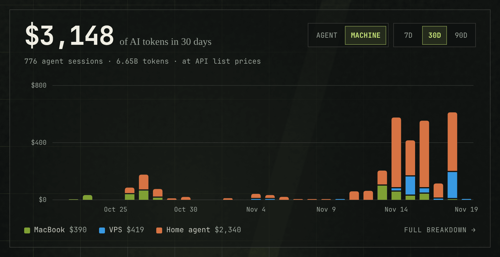

# big-spender

See what your AI coding agents would cost at API prices, summed across all your machines.

Each machine runs a small collector every hour. It reads that machine's Claude Code and Codex
session logs, works out hourly token and cost totals at [LiteLLM](https://github.com/BerriAI/litellm)
API prices, and posts one snapshot (the last 90 days) to a server you run. The server merges each
snapshot into that device's stored history, adds the devices together, and serves the totals as
JSON and as a plain HTML page. You can also embed the server side in your own app and draw the
numbers however you like.



The card above is on [jeffreyyvdb.com](https://jeffreyyvdb.com). The site mounts
`big-spender/server` and draws its own chart from the summary, here 30 days of daily cost stacked
by machine.

Cursor keeps usage on its servers, so one machine can also read your Cursor account's usage from
Cursor's API and send it as its own device. See [Cursor](#cursor).

The collector has no dependencies and needs Node 20 or newer. The package depends on `zod` only.

## What leaves the machine

Only numbers, model names, UTC timestamps, the device id and the pricing source. No paths, working
directories, prompts, session ids or git branches. Session ids are hashed on the device and only
their counts are sent. The server rejects any snapshot with extra fields, so nothing else can be
stored or served even by a modified collector.

The server never publishes a device's report time (it would show when each machine is online), and
nothing is bucketed finer than a UTC day: 7, 30 and 90 days are per day, all time is per ISO week
(Monday UTC). Device ids are published only if you leave
`unknownDevices` at its default, see [Device names and colours](#device-names-and-colours).

Usage limit windows (see [Usage limits](#usage-limits)) are sent as a window name, its reset time,
a peak percentage and, when a request was refused, the time of the first refusal. They never name a
device, and `/api/usage/limits` publishes them per UTC day only.

Before the first send you can see exactly what would leave the machine with
`big-spender push <device> --dry-run`.

With [Cursor](#cursor) set up, the collector also calls Cursor's API with your Cursor API key. It
sends Cursor only the key and a date range. From the answer it keeps model names, token counts,
cost and timestamps, the same as from local logs. Conversation ids are hashed on the device and
only counted, like session ids. Everything else in the answer, such as your Cursor user id, is
dropped.

## Quick start

### 1. Run the server

With Docker:

```sh
docker build -t big-spender .
docker run -d -p 8787:8787 \
  -e BIG_SPENDER_INGEST_TOKEN="$(openssl rand -hex 32)" \
  -v big-spender-data:/data \
  big-spender
```

Or with Node:

```sh
export BIG_SPENDER_INGEST_TOKEN="$(openssl rand -hex 32)"
npx big-spender serve --port 8787 --data ./data
```

Keep the token: every collector needs it. Open `http://localhost:8787/` for the page and
`http://localhost:8787/api/usage` for the JSON. Without a token the server still runs, but ingest
answers `503`.

Put the server behind HTTPS (a reverse proxy is enough) before collectors on other machines post to
it. The token travels in an `Authorization` header.

### 2. Install the collector on each machine

```sh
npx big-spender install --device laptop --url https://example.com/api/usage/ingest
```

It asks for the token with a hidden prompt (or reads `BIG_SPENDER_INGEST_TOKEN` from the
environment, or the existing env file). There is deliberately no flag for it, so it never ends up
in your shell history or process list. Then it:

1. copies the collector to `~/.local/share/big-spender/collector.mjs`,
2. writes `~/.config/big-spender/env` (mode 600) with the device id, URL and token,
3. schedules it hourly, and runs it once.

The device id is a lowercase slug (`laptop`, `desktop`, `build-box`). Run the command again any
time to update the installed copy or change the URL; it converges to the same state.

The id is fixed once a machine has one. `install --device <other>` stops with an error, because the
server keeps the old id's `<id>.json` and would count the same 90 days again under the new id. If
you do mean to rename the device, pass `--rename` and delete the old device's file on the server.

| System | Schedule                                                                                                                                                                                                                                        |
| ------ | ----------------------------------------------------------------------------------------------------------------------------------------------------------------------------------------------------------------------------------------------- |
| Linux  | systemd user units `big-spender.service` and `big-spender.timer` (`OnCalendar=hourly`, `Persistent=true`). Log: `journalctl --user -u big-spender`. On a headless box, `loginctl enable-linger $USER` keeps the timer running while logged out. |
| macOS  | LaunchAgent `~/Library/LaunchAgents/local.big-spender.plist` (minute 0 of every hour, and at login; a run missed during sleep fires on wake). Log: `~/Library/Logs/big-spender.log`.                                                            |

Remove the schedule with `big-spender uninstall`. The env file and the state are kept.

`big-spender status` prints the last 24 hours on this machine and sends nothing.

### Cursor

Cursor keeps usage on its servers, per account, so the collector reads it from Cursor's API
instead of local files. The server must run the big-spender release that added Cursor, or newer.
An older one answers the `cursor` snapshot with `422`. Set it up on one machine only:

```sh
npx big-spender install --device laptop --cursor
```

Only the account's personal usage is read. Usage billed to a Cursor team is not read yet.

It asks for a Cursor user API key with a hidden prompt (or reads `BIG_SPENDER_CURSOR_API_KEY`) and
adds it to the env file. Create the key in your Cursor dashboard. Running `install` again without
`--cursor` keeps the key; with `--cursor` it asks for a new one.

Cursor usage is sent as its own device, `cursor`, not as the machine that reads it, because one
account covers every machine you use Cursor on. If you move the key to another machine, remove it
from the first one, or both would send the same usage. Add `cursor` to your
[devices file](#device-names-and-colours) to give it a name and colour.

The first run sends all of the account's history that has token counts. Cursor billed per request
until about June 2025 and reported no tokens for those events, so they are skipped. Later runs
send the last 90 days, and the server keeps the older days. The full history is sent again until a
server has stored it, so a failed first run, a new ingest URL or a new API key gets it on the next run.

Cost is Cursor's own price for each event (`totalCents`), not LiteLLM's. Cursor's model names
mostly don't match LiteLLM's, and models such as Composer have no API price at all. Cursor reports
one price per event, so the split over input, cache read, cache write and output uses fixed ratios
of 1, 0.1, 1.25 and 5. The total is Cursor's, up to rounding each part to a millionth of a dollar.

A Cursor failure, such as a revoked key, does not stop the machine's own snapshot. The run still
posts it, then exits with an error that names Cursor. That includes a Cursor answer with fewer
events than it counted: posting it would replace complete days on the server with partial ones. The
device id `cursor` is reserved for this snapshot, so no machine can report under it. To switch to
another Cursor account, stop the server, run `big-spender install --cursor` with the new key, remove
`cursor.json` from the server's data directory, and start the server again. The install's own first
run fails while the server is down, which is expected. The next run sends the new account's full
history. The server keeps snapshots in memory, and the old key keeps posting until it is replaced,
so in any other order the two accounts' histories can be merged. `big-spender push` never reads
Cursor.

## The server

`big-spender serve` is a small `node:http` server:

| Route                        | What it does                                                                                                                                                                                             |
| ---------------------------- | -------------------------------------------------------------------------------------------------------------------------------------------------------------------------------------------------------- |
| `POST /api/usage/ingest`     | Collectors post a snapshot here (gzip or plain JSON, bearer token).                                                                                                                                      |
| `GET /api/usage`             | Merged totals for 7, 30 and 90 days and all time as JSON, with `cache-control: public, max-age=300, stale-while-revalidate=900`.                                                                         |
| `GET /api/usage/limits`      | Subscription limit hits per provider and window over the last 90 UTC days, per day, same cache header. See [Usage limits](#usage-limits).                                                                |
| `GET /api/usage/limits/hits` | Admin only: bearer `BIG_SPENDER_ADMIN_TOKEN`. Every recorded limit hit with its exact time and the device ids that saw it, earliest first. `cache-control: no-store`. See [Usage limits](#usage-limits). |
| `GET /`                      | A plain server-rendered page: totals per range, devices with colour swatches, top models, limit hits. No JavaScript, no external assets, light and dark.                                                 |
| `GET /healthz`               | `ok`, for load balancers and Docker.                                                                                                                                                                     |

Configuration comes from flags or environment variables (flags win):

| Flag        | Environment                | Default                                              |
| ----------- | -------------------------- | ---------------------------------------------------- |
| `--port`    | `PORT`                     | `8787`                                               |
| `--host`    | `HOST`                     | `0.0.0.0`                                            |
| `--data`    | `BIG_SPENDER_DATA_DIR`     | `./data` (`/data` in the Docker image)               |
| `--devices` | `BIG_SPENDER_DEVICES_FILE` | none: `{ "devices": {}, "unknownDevices": "by-id" }` |
|             | `BIG_SPENDER_INGEST_TOKEN` | none: ingest is off and answers `503`                |
|             | `BIG_SPENDER_ADMIN_TOKEN`  | none: the hits endpoint is off and answers `503`     |

The data directory holds one `<device>.json` file per device, written atomically. Put it on a
persistent volume. Each snapshot is merged into the device's stored history. A day the snapshot
reports replaces that day for each provider and model. Days it does not report are kept as day
rows, so the server keeps usage from beyond the collector's 90-day window, and the all-time range
shows it. All time has no session count (`sessions: null`): collectors count distinct sessions
on the device for 7, 30 and 90 days only. A device file holds at most 50,000 rows. Past that, the oldest kept days are dropped
and the server logs a warning. A snapshot older than the stored one is ignored (`"result":
"stale"`), so retries and duplicate posts are harmless. Files in the directory that are not valid snapshots are ignored with a warning.

Ingest limits: request bodies up to 2 MB, 16 MB after decompression, `gzip` or `identity` encoding
only. An invalid snapshot gets `422` with the first five problems. Dates before 2020-01-01 are
invalid.

### Device names and colours

Collectors identify themselves by device id. The server maps each id to the name and colour it
publishes. Point `--devices` at a JSON file:

```json
{
	"devices": {
		"laptop": { "name": "Laptop", "color": "#7fa034" },
		"desktop": { "name": "Desktop", "color": "#3899e2" }
	},
	"unknownDevices": "by-id"
}
```

Devices are listed in the order you write them. A device that is not listed is, by default,
shown under its own id with the next free colour. Set `"unknownDevices": "other"` to merge all
unlisted devices into one "Other" line instead, so no id is ever published. Use this when ids are
hostnames you would rather keep private.

## Embed it in your own app

`big-spender/server` is the same code the standalone server runs, behind web-standard `Request` and
`Response` objects, so any framework can mount it. SvelteKit:

```ts
// src/lib/server/usage.ts
import { createBigSpender } from 'big-spender/server';
import { env } from '$env/dynamic/private';

export const bs = createBigSpender({
	dataDir: env.USAGE_DATA_DIR ?? 'data/usage',
	ingestToken: env.USAGE_INGEST_TOKEN,
	devices: { devices: { laptop: { name: 'Laptop', color: '#7fa034' } }, unknownDevices: 'other' }
});

// src/routes/api/usage/ingest/+server.ts
import { bs } from '$lib/server/usage';
export const POST = ({ request }) => bs.ingest(request);

// src/routes/api/usage/+server.ts
import { json } from '@sveltejs/kit';
import { bs } from '$lib/server/usage';
export const GET = async ({ setHeaders }) => {
	setHeaders({ 'cache-control': 'public, max-age=300, stale-while-revalidate=900' });
	return json(await bs.summary());
};
```

Hono is the same shape (`app.post('/api/usage/ingest', (c) => bs.ingest(c.req.raw))`), and so is a
Next.js route handler (`export const POST = (request: Request) => bs.ingest(request)`).

`createBigSpender({ dataDir, ingestToken, adminToken?, devices })` returns:

- `ingest(request)`: handles a collector's `POST` and returns a `Response` (`503` when
  `ingestToken` is missing or empty, `401`, `413`, `415`, `422`, or `200` with
  `{ ok, deviceId, rows, result: 'stored' | 'stale' }`).
- `summary(now?)`: the merged totals for every range. The result is cached for five minutes and
  recomputed right after an ingest.
- `limits(now?)`: the [usage limit](#usage-limits) summary, cached the same way.
- `limitHits(request)`: the admin-only hit list as a `Response`. It answers `503` when `adminToken` is missing, empty or equal to `ingestToken`, `401` for a wrong bearer token, and `200` with `cache-control: no-store`. It is computed fresh on each call.

The module also exports `summarize(snapshots, now, config)`, `summarizeLimits(snapshots, now)`, `limitHits(snapshots, now)`, the
snapshot schema (`usageSnapshotSchema`, `limitWindowSchema`, `MAX_LIMIT_WINDOWS`), `resolveDevices`, `RANGES`, `PROVIDERS` and the types, for building your
own storage or charts.

## Usage limits

Besides cost, the collector records when you run out of your Claude and Codex subscription
allowance, so you can judge whether a plan fits how you work. It reads what the agents write to
their local logs, and it polls their usage endpoints (see [Polling](#polling-usage-endpoints)).

- **Claude Code.** A refused request is logged as an `assistant` line with `error: "rate_limit"`
  and a `quotaLimits` object that names the window (`five_hour`, `seven_day`, a model-specific
  weekly window such as `seven_day_opus`) and when it resets. Retries repeat the line, so one
  blocked window becomes one record. Claude Code logs nothing when a request is allowed, so the logs
  alone say nothing about utilisation below 100%; polling fills that in.
- **Codex.** `token_count` events carry `rate_limits` with the used percentage and reset time of the
  5-hour window (`five_hour`, 300 minutes) and the weekly window (`seven_day`, 10080 minutes). A
  window counts as hit when its share reaches 100%. A refused turn is logged too, but names no
  window and no reset. It starts the lockout of each Codex window seen full (by a poll or any log
  line) that was open at that moment, so the lockout begins at the first logged refusal instead of
  at the next poll. When no open window was seen full, a lockout that began and
  ended between two runs can still be placed by elimination. Usage in a window instance only rises
  until it resets, so a poll that read an instance below 100% after the refusal proves it was not
  the one blocking. This needs a successful poll in the same run that read both Codex windows, and
  every limit it reports must have an instance on file that was open at the refusal. If exactly one open window is then left,
  it gets the hit at the refusal. The gap that remains is a refusal whose window no reading ever
  saw, one where several windows stay possible, and any refusal read while polling is off or
  failing. These change nothing.

A record is one window instance, identified by provider, window name and reset time rounded down
to the minute. Reports whose resets are at most two minutes apart are the same window, because one
window's reported reset can drift by a few seconds. A push sends at most the 5,000 newest records,
the most the server accepts. It holds the peak percentage seen and the time of the first refusal. Limits belong
to the account, not the machine, so merging keeps the highest peak and the earliest refusal, and
two machines that report the same window count once. Records are kept for 90 days on the collector and up to 5,000 windows on the
server, like day rows.

`GET /api/usage/limits` returns, for each provider and window over the last 90 UTC days, how many
window instances were seen, how many were hit, the hours locked out (first refusal until reset),
the day of the last hit and a per-day series. Claude can move a window's reset later while you are
blocked, so a refusal before the previous reset extends that lockout instead of counting a new hit. A window counts on the day of its first refusal, or
of its reset when it was never refused; a window that is still open counts on today with its peak
so far. It follows the same privacy rule as the rest: nothing
finer than a UTC day, no device names, no report times. It is separate from `/api/usage`, whose
shape did not change. `big-spender status` also lists the limits hit in the last 7 days, to the
minute, because that output never leaves the machine.

`GET /api/usage/limits/hits` is the admin view. It needs `Authorization: Bearer <BIG_SPENDER_ADMIN_TOKEN>`
and returns every recorded hit with its exact `hitAt`, the window's reset and the devices that saw it,
earliest first. The public endpoint stays day-level with no devices. The admin token must differ from
the ingest token, because every collector machine holds that one. A hit found by polling carries the
poll time, not the exact refusal time. Two devices that show the same `hitAt` to the millisecond read
the same log line.

### Polling usage endpoints

Logs only show a limit when a request is refused, which hides how much of a window you leave
unused. So each run also asks Anthropic and OpenAI how full your windows are right now, the same
numbers `/usage` in Claude Code and Codex show. Claude is polled at `api.anthropic.com` and Codex at
`chatgpt.com`, with the login the agent already keeps: `~/.claude/.credentials.json`
(`$CLAUDE_CONFIG_DIR` if set) and `~/.codex/auth.json` (`$CODEX_HOME` if set). The collector opens
those files read-only, never refreshes them and sends the token only to that provider. If a token
has expired, that provider is skipped with one warning until you run the agent again. A missing
file means that provider is not polled, without a warning. A failed poll never fails the run.

Each reading is a peak for the same window record the logs feed. Windows are named `five_hour` and
`seven_day`, plus one `seven_day_<model>` per model-specific weekly (`seven_day_fable`,
`seven_day_opus`). Codex's extra limits become `<window>_<limit name>`. Only the window name, reset
time and percentage are stored or sent.

Claude Code logs a refusal of Fable's weekly as `seven_day_overage_included` and labels it "Fable
limit". The endpoint reports the same limit as `seven_day_fable`, so the collector records those
refusals as `seven_day_fable`, and they join the polled readings in one record.

To turn polling off, set `BIG_SPENDER_POLL_LIMITS=off` in the env file.

An older server rejects the unknown `limits` field with a 422. The collector and `push` then send
the snapshot again without it and print a warning on each run, so usage keeps arriving. Upgrade the server to store
limits.

## Push by hand

For a machine that should only report now and then, or where you would rather not store a token:

```sh
big-spender push laptop --dry-run   # review only: per-model overview, the exact JSON, never sends
big-spender push laptop             # same review, then asks before sending
```

It builds the snapshot and lists the model names it would publish. It stops if a name looks like a
cloud resource id or gateway path (it contains `arn:` or `/`), such as a Bedrock inference-profile
ARN with an account id in it. It asks before sending, sends exactly the JSON it showed, and takes
the URL from `--url`, `BIG_SPENDER_INGEST_URL` or a prompt, and the token from
`BIG_SPENDER_INGEST_TOKEN` or a hidden prompt. Neither is stored. Nothing is scheduled, so the
server shows that device's usage as of its last push.

`--dry-run` writes the JSON that would be sent to `$TMPDIR/big-spender-snapshot-<device>.json`.

## Check the numbers

```sh
big-spender status                          # last 24 hours on this machine, nothing sent
node ~/.local/share/big-spender/collector.mjs --dry-run   # the full snapshot JSON, nothing sent
```

With [Cursor](#cursor) set up, `--dry-run` reads Cursor too and prints the `cursor` snapshot after
this machine's.

Compare with [ccusage](https://github.com/ryoppippi/ccusage) on the same machine. Use the `claude`
subcommand: plain `npx ccusage` also adds other CLIs that the collector does not read. Claude Code
tokens and cost should match per model:

```sh
npx ccusage@latest claude daily --since 20260819 --breakdown
```

ccusage groups by local date and the collector by UTC hour, so single days can shift a little at the
edges. Tools that price every cache write at the 5-minute rate and ignore long-context prices show
about 15 to 20 percent less.

## How it counts

| Source                            | Files                                                                                                                                                | Notes                                                                                                                                                                                                                                                                                                                                                                                                                                                                                                                                                                                                                                                                                                                                                                                                                                                                                |
| --------------------------------- | ---------------------------------------------------------------------------------------------------------------------------------------------------- | ------------------------------------------------------------------------------------------------------------------------------------------------------------------------------------------------------------------------------------------------------------------------------------------------------------------------------------------------------------------------------------------------------------------------------------------------------------------------------------------------------------------------------------------------------------------------------------------------------------------------------------------------------------------------------------------------------------------------------------------------------------------------------------------------------------------------------------------------------------------------------------ |
| Claude Code                       | `~/.claude/projects/**/*.jsonl`, `~/.config/claude/projects`, `$CLAUDE_CONFIG_DIR/projects`                                                          | `assistant` lines; de-duplicated by `message.id` + `requestId` (one API response is logged once per content block, and resumed sessions copy history). `<synthetic>` skipped; subagent logs included. Some Claude Code versions (2.1.293 to 2.1.310) log a partial output count on a message's first line and the final count on a later line; a later line that reports more output adds the difference.                                                                                                                                                                                                                                                                                                                                                                                                                                                                            |
| Codex                             | `~/.codex/sessions/**/rollout-*.jsonl`, `$CODEX_HOME/sessions`                                                                                       | `event_msg` / `token_count` with `info.last_token_usage`; skipped when `total_token_usage` did not change. Model from the latest `turn_context`. `cached_input_tokens` is part of `input_tokens`; reasoning is part of `output_tokens`.                                                                                                                                                                                                                                                                                                                                                                                                                                                                                                                                                                                                                                              |
| Cursor                            | Cursor's API, `DashboardService/GetFilteredUsageEvents`, with `BIG_SPENDER_CURSOR_API_KEY`                                                           | Events with token counts only. Cost is Cursor's `totalCents`. Events have no unique id and pages can overlap, so a time window with more than 1,000 events is split in half instead of paged. `cacheWriteTokens` count as 5-minute cache writes. Sessions are hashed `conversationId`s. Model names are lowercased, and anything outside `a-z 0-9 . _ : @ -` becomes `-`.                                                                                                                                                                                                                                                                                                                                                                                                                                                                                                            |
| pi                                | `~/.pi/agent/sessions/**/*.jsonl`, `$PI_CODING_AGENT_DIR/sessions`, `$PI_CODING_AGENT_SESSION_DIR`, `$PI_AGENT_DIR` (comma-separated, as in ccusage) | Assistant `message` entries with `usage`; `input` excludes cached tokens, reasoning is part of `output`, and `cacheWrite` counts as 5-minute writes except its `cacheWrite1h` part. Calls with no tokens (aborted, failed before a retry) are skipped, and a call with only `totalTokens` counts it as output. A fork's file starts with a copy of its parent's calls up to the fork; those leading calls are skipped when the parent file has them. ccusage looks only at the parent's current branch, so it counts the copy again once the parent moves to another branch. A model id that is a file path (absolute, a `file://` or `host:/` URL, or ending in `.gguf` and similar) is reduced to its file name. `subagent-artifacts/` transcripts are skipped. Cost is LiteLLM's, not the cost pi stores.                                                                         |
| Grok Build (experimental)         | `~/.grok/sessions/**/updates.jsonl`, `$GROK_HOME/sessions`                                                                                           | **Experimental:** checked against ccusage on test fixtures built from its Grok parser tests, not yet against real Grok Build logs. `turn_completed` lines, one row per model in `usage.modelUsage` (the top-level usage under `summary.json`'s `current_model_id` when that map is missing). De-duplicated by `eventId` + model, also across sessions, since one event can be exported into several; a row without `eventId` by its full content within its file. `cachedReadTokens` and `cacheCreationTokens` are part of `inputTokens`; reasoning is part of `outputTokens`. Always the base rate: a turn sums several API requests, so its total cannot pick the long-context tier; a request of its own above 200K tokens is under-priced. A model id that is a file path is reduced to its file name. A turn cut off before it completes is never logged, so it is not counted. |
| GitHub Copilot CLI (experimental) | `~/.copilot/session-state/*/events.jsonl`, `$COPILOT_HOME/session-state`                                                                             | Experimental: so far compared with ccusage only on a few sessions from one machine and on ccusage's test fixtures, not on regular use. `session.usage_record` events (one per model call). Older versions log only `session.shutdown`; its cumulative `modelMetrics` count as the growth since the previous shutdown, and only when no per-call record came in that interval. `inputTokens` includes cache reads and writes, so input counts uncached tokens only. Reasoning is part of `outputTokens`. A `-1m` or `-1m-internal` model suffix is dropped. Only the top-level `events.jsonl` of each session is read, not the OpenTelemetry export or `session-store.db`.                                                                                                                                                                                                            |
| Antigravity (experimental)        | `~/.gemini/antigravity*/conversations/**/*.db`, `~/.config/antigravity/conversations`                                                                | **Experimental:** read only with `BIG_SPENDER_EXPERIMENTAL=antigravity`; checked against ccusage on test fixtures, not yet against real Antigravity data. `antigravity*` is `antigravity` and its `-cli`, `-ide`, `-backup` and `-acp` variants; `$ANTIGRAVITY_DATA_DIR` (comma-separated) is read too. Read with `node:sqlite` (Node 22.13+, else skipped with a warning). Usage messages in `gen_metadata` and `steps`, retries included; copies sharing a response, provider or message id merge and keep the largest counts. A later copy can move a response to another day or model; the day and model it left are sent as a zero row, which takes them back on the server. A model name with a slash (possibly a path) becomes `gemini-internal-model`. Reasoning is part of output.                                                                                          |
| Gemini CLI (experimental)         | `~/.gemini/tmp/**/*.json` and `*.jsonl`, `$GEMINI_DATA_DIR` (comma-separated)                                                                        | **Experimental:** read only with `BIG_SPENDER_EXPERIMENTAL=gemini`; checked against ccusage on test fixtures, not yet against real Gemini CLI data. `gemini` chat messages with `tokens`, and saved headless `stats` (per model, or with the last model named, else `unknown`). A changed file is read whole and its counts replace what it counted before, as ccusage counts each file as it is; in JSONL the last copy of a message id counts. `input` excludes `cached` when the total shows it was inside (always in stats), and `tool` tokens count as input. Reasoning (`thoughts`) and any total beyond the parts count as output, as ccusage bills them, though its per-model output leaves reasoning out. A model id that is a file path is reduced to its file name. `$GEMINI_DATA_DIR` adds dirs to the default rather than replacing it.                                 |

**Pricing.** Claude Code, Codex, pi, Grok Build, GitHub Copilot CLI, Antigravity, Gemini CLI and OpenCode use LiteLLM
| OpenCode | `~/.local/share/opencode` (or `$XDG_DATA_HOME/opencode`), or `$OPENCODE_DATA_DIR` (comma-separated, replaces the default): `opencode.db` and pre-SQLite `storage/message/**/*.json` | Assistant messages, and `completed` compaction rows, from the 1.x `message` table, the 2.x `session_message` table and the JSON files. The first copy of a message id wins, because 2.x copies the 1.x rows; A 2.x fork's copies of its parent's rows keep the parent rows' times, so rows older than the fork are skipped, as OpenCode's own stats do; this holds after the parent is deleted, and a parent deleted before big-spender read it is not counted. Needs `node:sqlite` (Node 22.13+). OpenCode rewrites a running message, so each run reads the window again and adds what changed; an hour and model a message left are sent as a zero row, which takes them back on the server. Cache reads and writes are outside `input`. 1.x counts reasoning in `output`; 2.x does not, so it is added. `claude-agent` rows are skipped, because the Claude Code source counts them. A model id that is a file path, a URL, or ends in a model-file extension (`.gguf`, `.safetensors`, ...) is cut to its file name, without query or login; an address with no file name is sent as `local`. OpenCode's own `cost` is not used; a model is priced under the first upstream it was seen on. |
`model_prices_and_context_window.json`, cached for 24 hours in `~/.cache/big-spender/`. Each source lists the LiteLLM keys to try for a model. Claude
Code and Codex try the exact model, then the `anthropic/` or `openai/` prefix, then without a date
suffix. pi tries the LiteLLM prefixes of the providers pi supports too (`openrouter/`, `fireworks_ai/`,
`groq/` and others). For an OpenRouter id such as `anthropic/claude-sonnet-4.5` it then tries
`claude-sonnet-4.5` and `claude-sonnet-4-5`. Grok Build tries the model and its `xai/` key, then
both without a trailing `-build`. Antigravity tries the model, the model without an effort or `-thinking`
suffix, Anthropic's spelling of a Claude name (`claude-sonnet-4-5` for `claude-4.5-sonnet`) and the
`-preview` name, each bare and with the `google/`, `gemini/`, `vertex_ai/` and `openrouter/google/`
prefixes (a Claude name also with `vercel_ai_gateway/anthropic/`, which still lists retired models).
Gemini CLI tries `gemini/`, `vertex_ai/` and `openrouter/google/`, then the bare model. ccusage prices
Gemini from models.dev's `google/` entries first, and for `gemini-2.5-flash` that entry is $0.15
input and $1.25 output per million tokens, half of LiteLLM's (and models.dev's own `gemini/` entry)
$0.30 and $2.50. So ccusage shows about half the collector's cost for that model.
OpenCode tries the model, then under the upstream provider it ran on. Unknown models count with cost 0 and log a warning.
Long-context tiers
(`*_above_<N>k_tokens`) are applied per request; a missing cache price is derived from the base
input price, also above a tier, as ccusage does. 1-hour cache writes use
`cache_creation_input_token_cost_above_1hr`. Cache savings are cache-read tokens times (input price
minus cache-read price). Copilot also tries `github_copilot/<model>`, and swaps a dot between digits
for a dash in Claude model names (`claude-opus-4.6` is priced as `claude-opus-4-6`).

**Experimental sources.** A source whose counts match ccusage on test data but have not been checked
against real usage yet is marked `experimental` in `SOURCES`. The collector reads and sends it only
when `BIG_SPENDER_EXPERIMENTAL` (comma-separated provider ids, in the environment or the env file)
names it. Antigravity and Gemini CLI are gated this way. Removing it from the list stops sending its rows on the
next run; adding it back recounts them without counting anything twice.

**Adding a provider.** Add an entry to `SOURCES` in `src/collector.mjs`, the provider id to
`PROVIDERS` in `src/schema.ts`, a row to the table above, and a test with a fixture log. The entry
says where the data lives, how it is read, and which LiteLLM keys price its models. Append-only JSONL
uses `jsonlReader`, which parses only new bytes. Other formats are read whole on every run and skip
what they counted before through `state.seen`. A SQLite file opens with `openSqlite`, which skips the
source with one warning on a Node without `node:sqlite`. Add the matching ccusage agent to `AGENTS`
in `scripts/parity-ccusage.mjs` and run `node scripts/parity-ccusage.mjs <provider>`: tokens must
match ccusage exactly. `node scripts/parity-ref.mjs` shows that the other providers did not change.
Deploy the server before the collectors, because a server rejects rows from a provider it does not
list.

**Incremental.** `~/.cache/big-spender/state.json` keeps per-file byte offsets plus the hourly
aggregates, so each run parses only new bytes but still sends the full 90-day snapshot. Rows older
than 7 days are rolled up to daily rows. Because the aggregates live in the state file, usage stays
counted even after Claude Code deletes old session logs. `--reset` rebuilds from the logs that still
exist, so avoid it unless the state is corrupt.

Limit windows live in the same state file. The first run after the update re-reads every log once
to pick up limit lines older runs skipped; it adds no usage.

State from an older collector is fixed in place on the first run of a newer one (for example, one
re-read of the Claude logs to pick up missed output tokens), so updating never needs `--reset`.

A machine that was off catches up on its next run. A failed post retries with backoff and exits
non-zero; the token is never logged. A token with a space, a control character or anything else an
HTTP header cannot carry fails at once, without a retry, in both the collector and `push`.

## Coming from the earlier standalone script

`big-spender install` migrates an install of the earlier `usage-collector` script in place: it
removes the old systemd units or LaunchAgent, moves its config and state (so history is kept byte
for byte), renames the `USAGE_*` keys in the env file to `BIG_SPENDER_*`, and deletes the old copy
of the script. If `status` or `push` already made a new cache, the old state replaces it only while
the old collector is still scheduled or wrote its state last; otherwise the old cache is left in
place and the newer one kept. If the old collector, or a `status` or `push` whose cache would be
replaced, is running at that moment, install changes nothing and asks you to run it again. The
collector still reads `USAGE_DEVICE_ID`, `USAGE_INGEST_URL` and `USAGE_INGEST_TOKEN` when the
`BIG_SPENDER_*` name is unset, so a machine you have not updated keeps working.

## Development

```sh
npm install
npm run build     # tsc, then copies the collector into dist/
npm run check     # type check
npm test          # node:test; needs Node 22.18 or newer, which runs the TypeScript directly
```

The tests never call `systemctl` or `launchctl` and never touch your real config or cache:
`BIG_SPENDER_SCHEDULER=none` turns scheduler calls into no-ops, and each test runs in a throwaway
`HOME`.

## License

MIT
